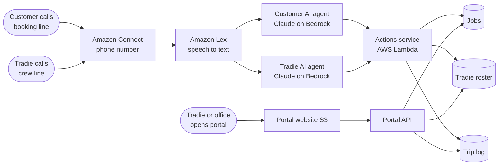
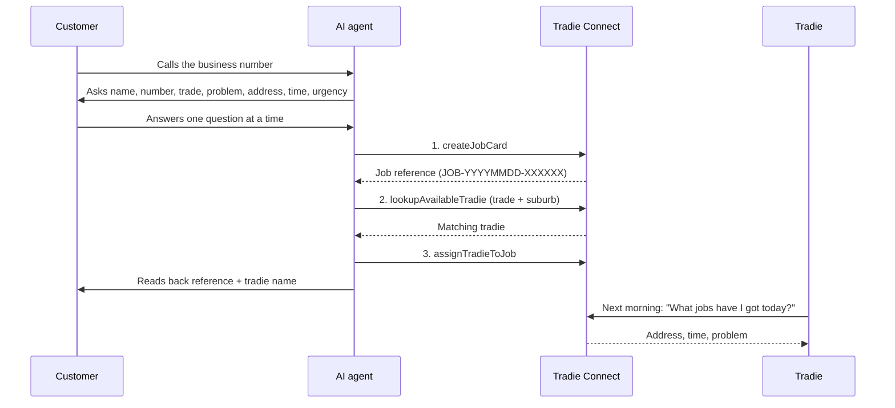
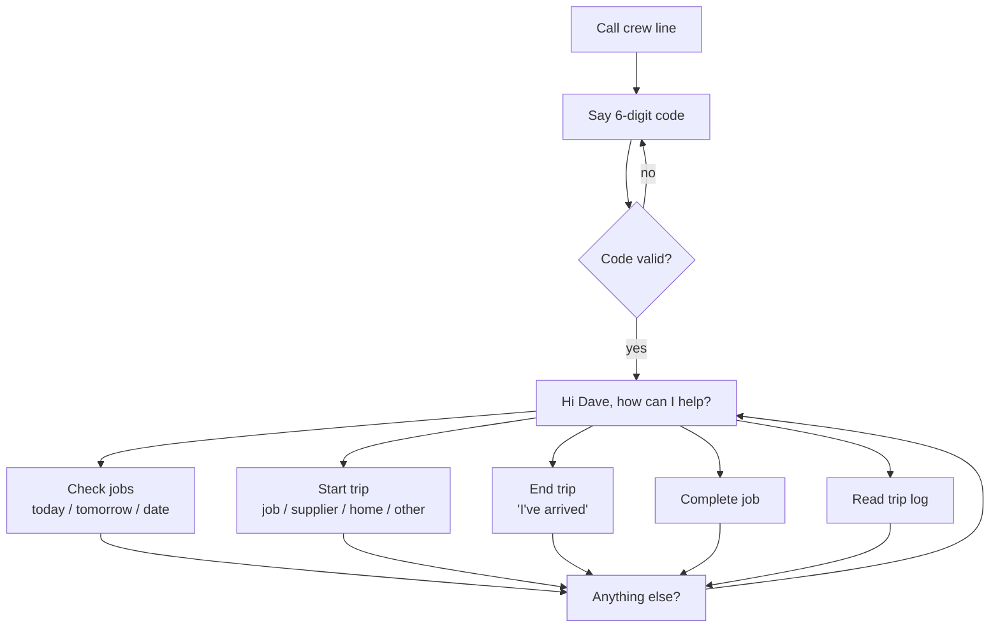
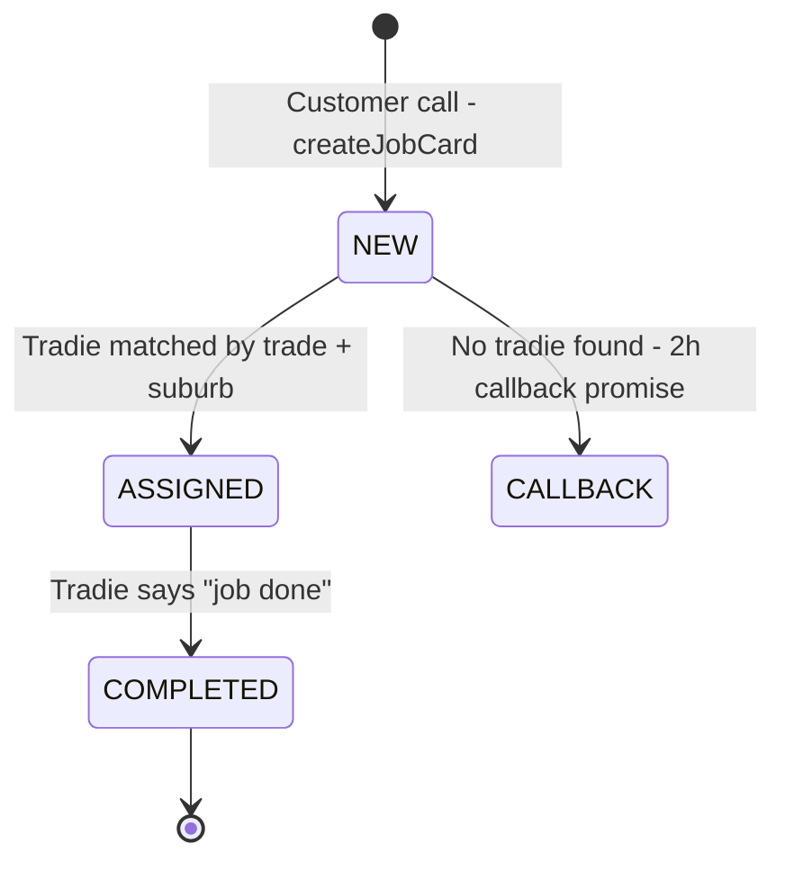
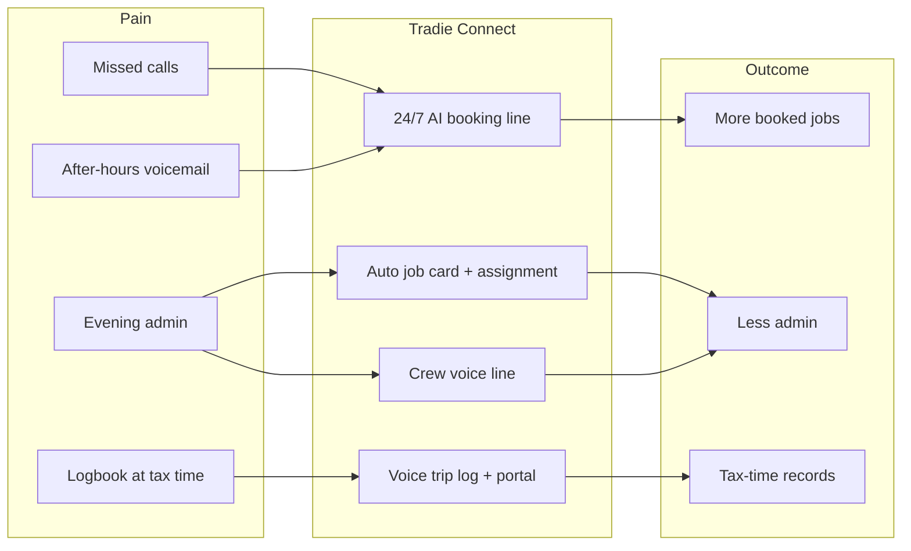

# Tradie Connect — Diagrams

Mermaid diagrams. They render on GitHub, Notion, Obsidian, and mermaid.live (export to PNG/SVG for slides).

## 1. System overview

## 2. A booking, step by step

## 3. A tradie's day on the crew line

## 4. Job lifecycle

## 5. Value map (for slides)

